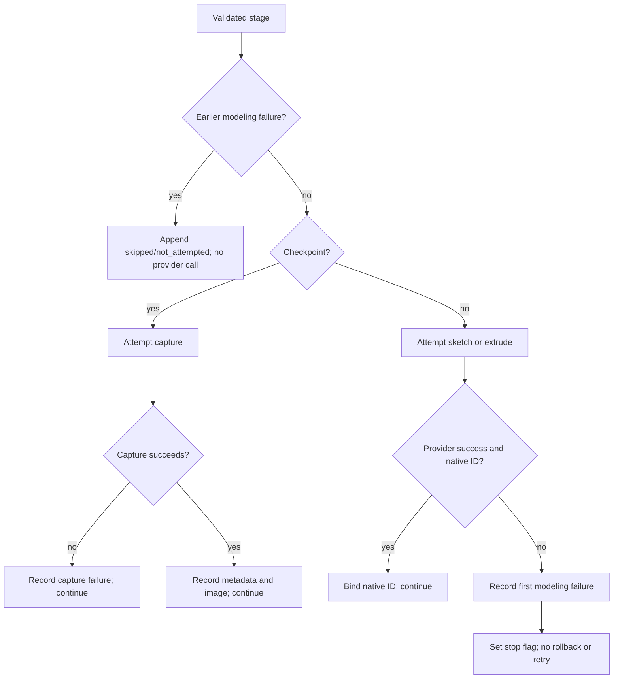

# Technical Design: Onshape Part Orchestrator

**Change:** `onshape-part-orchestrator`  
**Artifact store:** OpenSpec  
**Scope:** additive implementation in `McpCad.Tools` and `McpCad.Tests`; no provider-contract expansion  
**Public tool:** `onshape_orchestrate_part(address_json: string, plan_json: string)`

## 1. Design summary

Add a new partial implementation of `McpCad.Tools.Onshape.OnshapeSkillTools` that adapts the two MCP string arguments into a strict, typed, immutable plan. A parser rejects duplicate, unknown, missing, and mistyped JSON members. A validator preflights the complete address and plan and compiles all sketch payloads before any `ICadWebProvider` call. A per-invocation executor then processes sketch, extrude, and checkpoint stages sequentially, resolving plan-local sketch IDs to native Onshape feature IDs returned by earlier successful writes.

The implementation reuses:

- `CadElementAddress` as the provider-facing address model;
- `ICadWebProvider.SketchReplace`, `FeatureAdd`, and `CaptureView` as the only provider calls;
- `OnshapeSketchBuilder.BuildRectangle`, `BuildCircle`, and `BuildClosedProfile`;
- `OnshapeMixedProfileFacade.BuildMixedClosedProfile` and its existing `MixedClosedProfile`, `MixedProfilePointCm`, `MixedProfileLineSegment`, and `MixedProfileThreePointArcSegment` contracts;
- `OnshapeFeatureTemplates.ExtrudeFromSketch`;
- `OnshapeUnitConversion.CmToMeters`;
- `CallToolResult`, `ContentBlock`, and `ImageContentBlock.FromBytes` from `ModelContextProtocol.Protocol`.

`skill_onshape_god_part`, `OnshapeGodPartCapture`, `ICadWebProvider`, `OnshapeProvider`, `PartStudioManager`, and the payload builders remain behaviorally and structurally unchanged. The new tool is discovered through the existing `[McpServerToolType]` registration of `OnshapeSkillTools`; `McpCad.Server/Program.cs` needs no registration change.

This is a finite executor, not an interpreter: there are no expressions, loops, branches, raw bodies, arbitrary feature names, reflection dispatch, topology selectors, or graph scheduling.

## 2. Public contract and internal model

### 2.1 MCP adapter

A new partial method on `OnshapeSkillTools` has the exact signature:

```csharp
[McpServerTool]
public CallToolResult onshape_orchestrate_part(
    string address_json,
    string plan_json)
```

The adapter has only four responsibilities:

1. call the strict parser;
2. call complete preflight validation/compilation;
3. execute the validated plan against the injected instance `ICadWebProvider`;
4. project the typed execution result into one `CallToolResult`.

It does not invoke other MCP tools internally. Dependency injection remains constructor-scoped through the existing primary constructor `OnshapeSkillTools(ICadWebProvider provider)`.

### 2.2 Exact address parsing

`CadElementAddress.Deserialize` uses ordinary `JsonSerializer` behavior and therefore is not sufficient for this tool's duplicate/unknown-member requirement. The orchestrator parser will inspect `address_json` itself, then construct the existing `CadElementAddress` record.

The address object allows exactly:

- required `documentId`: non-empty JSON string;
- required `workspaceOrVersionId`: non-empty JSON string;
- optional `microversionId`: when present, a non-empty JSON string;
- required `elementId`: non-empty JSON string.

Unknown names, duplicate names, missing required names, `null`, and wrong JSON kinds are rejected. Member names and values are case-sensitive. This stricter entry-point parser does not alter `CadElementAddress.Deserialize` for existing tools.

### 2.3 Closed plan and profile types

The parser creates internal immutable records; these are not general-purpose serializer DTOs:

```csharp
internal sealed record OnshapePartPlan(
    int SchemaVersion,
    ImmutableArray<OnshapePlanStage> Stages);

internal abstract record OnshapePlanStage(string Id);
internal sealed record SketchPlanStage(
    string Id, CanonicalSketchPlane Plane, ClosedProfile Profile)
    : OnshapePlanStage(Id);
internal sealed record ExtrudePlanStage(
    string Id, string SketchId, ExtrudeOperation Operation,
    double DepthCm, ExtrudeDirection Direction)
    : OnshapePlanStage(Id);
internal sealed record CheckpointPlanStage(
    string Id, string AfterStageId, CheckpointView View)
    : OnshapePlanStage(Id);

internal enum CanonicalSketchPlane { Top, Front, Right }
internal enum ExtrudeOperation { New, Add, Remove }
internal enum ExtrudeDirection { Positive, Negative }
internal enum CheckpointView { Iso, Top }

internal abstract record ClosedProfile;
internal sealed record RectangleProfile(
    double X1Cm, double Y1Cm, double X2Cm, double Y2Cm) : ClosedProfile;
internal sealed record CircleProfile(
    double CxCm, double CyCm, double RadiusCm) : ClosedProfile;
internal sealed record PolygonProfile(
    ImmutableArray<SketchPoint> PointsCm) : ClosedProfile;
internal sealed record MixedProfile(
    MixedProfilePointCm Start,
    ImmutableArray<MixedProfileSegmentInput> Segments) : ClosedProfile;
```

The internal enums are closed discriminants. JSON tokens are accepted only with the exact spellings in the specification: stage `kind` values `sketch`, `extrude`, and `checkpoint`; profile `type` values `rectangle`, `circle`, `polygon`, and `mixed`; mixed segment `type` values `line` and `arc`; planes `Top`, `Front`, and `Right`; operations `new`, `add`, and `remove`; directions `positive` and `negative`; views `iso` and `top`. No aliases currently accepted by lower-level templates (`join`, `cut`, `intersect`, case variants) leak into this schema.

`PolygonProfile` intentionally uses the existing centimeter-space `SketchPoint` expected by `OnshapeSketchBuilder.BuildClosedProfile`. `MixedProfile` intentionally uses the public types accepted by `OnshapeMixedProfileFacade`, rather than introducing a second mixed-profile geometry representation.

### 2.4 Strict parser mechanics

Implement a small `OnshapePartPlanParser` over `JsonDocument`, not permissive polymorphic `JsonSerializer` deserialization. `JsonDocumentOptions` retain strict defaults: comments and trailing commas are not allowed. For every object, one helper enumerates properties once into a `HashSet<string>(StringComparer.Ordinal)` and:

1. rejects a duplicate before looking up values;
2. rejects any name outside that object's allowlist;
3. verifies all required names are present;
4. reads each member with an exact `JsonValueKind` check.

This helper is applied at every object level: address, plan root, each stage, every profile, every point, and every mixed segment. Thus duplicate detection is not lost through dictionary materialization or `TryGetProperty` last-value behavior.

Numbers require `JsonValueKind.Number`, successful `TryGetDouble`, and `double.IsFinite`. Integer `schemaVersion` requires `TryGetInt32`; `1.0`, strings, booleans, arrays, objects, and nulls are not coerced. Required strings must have `Length > 0` and must not be whitespace-only. Parse errors carry a JSON path such as `stages[3].profile.segments[1].through.x_cm`.

Stage parsing first validates the common `id` and `kind`, then dispatches through an explicit switch to the exact stage allowlist. Profile and mixed-segment parsing use equivalent explicit switches. No reflection or runtime subtype discovery is used.

## 3. Preflight and shared validation

### 3.1 Pipeline

No provider read, write, or capture is allowed until all of these steps succeed:

```text
raw address_json + raw plan_json
  1. strict JSON syntax and exact-object parsing
  2. strict CadElementAddress construction and address validation
  3. schemaVersion == 1
  4. total stage count 1..16; checkpoint count 0..3
  5. stage-local scalar/enum/value validation
  6. case-sensitive unique ID symbol-table construction
  7. backward-only and typed-reference validation
  8. latest-preceding-modeling-stage checkpoint validation
  9. complete profile geometry validation
 10. sketch payload compilation and disposal-safe serialization
 11. produce immutable ValidatedOnshapePartPlan
 12. only now may execution call ICadWebProvider
```

The parser handles exact shape and JSON types. `OnshapePartPlanValidator` handles bounds, semantics, symbol resolution, and geometry. It returns `ValidatedOnshapePartPlan`, containing the existing `CadElementAddress`, immutable validated stages, and prebuilt sketch request JSON/dictionaries. The executor accepts only this validated type, preventing accidental execution of a merely parsed plan.

### 3.2 Symbol table and typed references

Validation scans in declaration order with an invocation-local:

```csharp
Dictionary<string, StageSymbol>(StringComparer.Ordinal)
```

`StageSymbol` contains declaration index and closed stage kind, never a native ID. Insertion rejects duplicate IDs. An extrude lookup must already exist and have kind `sketch`; absence covers unknown, forward, and self references. A checkpoint lookup must already exist, have kind `sketch` or `extrude`, and equal the tracked latest preceding modeling stage ID. Checkpoints do not advance that tracker, so repeated checkpoints can target the same latest model stage.

At runtime, a separate invocation-local dictionary maps only successful modeling-stage plan IDs to opaque native feature IDs. Extrudes resolve `SketchId` from this runtime map. A valid plan cannot encounter a missing prior sketch ID unless an earlier modeling stage failed, in which case execution has already entered stop mode and the extrude is not attempted.

Plan IDs are never passed to Onshape and native IDs are never accepted from the plan.

### 3.3 Geometry reuse

Validation and payload compilation are one operation for sketches, so complex geometry is checked by the same code that will produce the request:

- rectangle: explicitly require finite coordinates and nonzero width/height, convert each coordinate with `OnshapeUnitConversion.CmToMeters`, then call `OnshapeSketchBuilder.BuildRectangle`;
- circle: explicitly require finite center coordinates and finite `radius_cm > 0`, convert once with `CmToMeters`, then call `OnshapeSketchBuilder.BuildCircle`;
- polygon: pass centimeter `SketchPoint` values directly to `OnshapeSketchBuilder.BuildClosedProfile`. Its existing normalization removes one repeated closing point, and its existing validation enforces 3..256 normalized vertices, uniqueness, area, nonzero edges, no adjacent backtracking, and no non-adjacent crossing/touching/overlap;
- mixed: construct the existing `MixedClosedProfile` and call `OnshapeMixedProfileFacade.BuildMixedClosedProfile`. Existing normalization/topology validation remains authoritative for derived starts, closure, 2..256 segments, at least one line and one arc, 1..8 arcs, finite/non-degenerate geometry, and non-negligible area.

The strict parser independently prohibits profile members not accepted by the corrected schema, including `start`/`mid` on individual segments. The resulting `JsonDocument` is serialized or materialized into an owned request value during preflight and disposed immediately. Execution therefore does not repeat sketch geometry validation or retain disposable documents.

Extrudes are statically checked for finite nonzero `depth_cm`, exact direction and operation enums, and a prior typed sketch reference. Execution passes the resolved native sketch ID plus `CmToMeters(depth_cm)`, exact direction, and exact operation to `OnshapeFeatureTemplates.ExtrudeFromSketch`. That existing template applies absolute depth/direction semantics, maps `new`/`add`/`remove`, emits the `BTMIndividualSketchRegionQuery-140`, and keeps `rejectMicroversionSkew: true`.

## 4. Sequential execution and native-ID normalization

### 4.1 Executor state

`OnshapePartPlanExecutor` is created per call or is a stateless service receiving all state as locals. Its only mutable data is local to `Execute`:

- ordered stage-result builder;
- ordered capture-result and image-block builders;
- plan-ID-to-native-feature-ID dictionary;
- `lastSuccessfulFeatureId`;
- first modeling failure;
- `modelingStopped` flag.

No static cache, singleton symbol table, cross-request feature map, or mutable global state is introduced.

### 4.2 Native feature result normalization

A small internal `OnshapeFeatureWriteResult` normalizer centralizes the response shape already defended by `OnshapeSkillTools.TryGetFeatureId`:

1. require provider result `success is true`;
2. prefer a non-whitespace top-level string `featureId`;
3. otherwise accept a non-whitespace nested `feature.featureId` string;
4. preserve the opaque string exactly; do not case-fold, parse, synthesize, or trim it;
5. if success is false, use the provider's non-empty string `error` or a stage-specific fallback;
6. if success is true but no usable ID exists, return `MISSING_NATIVE_FEATURE_ID`.

`PartStudioManager.SketchReplace` and `FeatureManager.FeatureAdd` already call `OnshapeJsonHelper.NormalizeFeatureWriteResponse`, which promotes nested `feature.featureId`; the nested fallback preserves compatibility with provider fakes and defensive behavior demonstrated by `skill_onshape_god_part` tests.

Only a normalized successful sketch native ID is supplied to `OnshapeFeatureTemplates.ExtrudeFromSketch`. The resulting POST body therefore links through the native ID, not the plan-local `sketchId`.

### 4.3 Stage algorithm

For each validated stage in declaration order:

- If `modelingStopped` is true, append a skipped result and make no call. A modeling stage gets `modelingStatus: "not_attempted"`; a checkpoint gets `captureStatus: "not_attempted"`. Unattempted checkpoints are omitted from `captures.results`, whose schema permits only completed/failed attempts.
- A sketch calls `provider.SketchReplace(address, compiledRequest)`. Provider false results, thrown exceptions, or missing native IDs fail that stage, record the first modeling error, and set `modelingStopped`.
- An extrude resolves its earlier sketch's native ID, builds the existing typed extrude envelope, and calls `provider.FeatureAdd(address, "extrude", null, bodyJson)`. Its success is normalized identically. Any failure stops later work.
- A checkpoint calls `provider.CaptureView(address, view, 800, 600, "show")`, matching the current `onshape_capture_view` defaults. Provider failure, exception, absent/blank `image_base64`, invalid base64, or failure to construct a PNG `ImageContentBlock` fails only that checkpoint. Execution continues while modeling has not failed.

There are no retries. Successful prior cloud writes are neither deleted nor compensated.

### 4.4 Sequence diagram

```mermaid
sequenceDiagram
    actor Caller
    participant Tool as OnshapeSkillTools
    participant Parser as OnshapePartPlanParser
    participant Validator as OnshapePartPlanValidator
    participant Executor as OnshapePartPlanExecutor
    participant Builder as Existing Onshape builders
    participant Provider as ICadWebProvider

    Caller->>Tool: onshape_orchestrate_part(address_json, plan_json)
    Tool->>Parser: Parse both strings exactly
    Parser-->>Tool: typed address input + closed stage union
    Tool->>Validator: Validate complete plan
    Validator->>Builder: Build/validate every sketch payload
    Builder-->>Validator: owned payloads
    Validator-->>Tool: ValidatedOnshapePartPlan
    Note over Tool,Provider: No provider call occurs before this point
    Tool->>Executor: Execute(validatedPlan)
    loop declaration order
        alt sketch
            Executor->>Provider: SketchReplace(address, payload)
            Provider-->>Executor: provider dictionary
            Executor->>Executor: normalize featureId; bind plan ID
        else extrude
            Executor->>Executor: resolve prior sketch plan ID
            Executor->>Builder: ExtrudeFromSketch(native ID, depth, direction, operation)
            Executor->>Provider: FeatureAdd(address, "extrude", bodyJson)
            Provider-->>Executor: provider dictionary
            Executor->>Executor: normalize featureId; bind plan ID
        else checkpoint
            Executor->>Provider: CaptureView(address, view, 800, 600, "show")
            Provider-->>Executor: metadata + image_base64 or failure
            Executor->>Executor: append capture result and optional image
        end
    end
    Executor-->>Tool: typed envelope + ordered images
    Tool-->>Caller: CallToolResult
```

### 4.5 Modeling failure branch



## 5. Result contract, statuses, and errors

### 5.1 Typed result projection

Use internal output records with explicit `JsonPropertyName` attributes (or an equivalent dedicated projection) so serialization produces exactly the corrected specification's property names and no implementation-only state:

- `OnshapeOrchestrationResult`;
- `ModelingSummary`;
- `StageExecutionResult`;
- `CapturesSummary`;
- `CheckpointCaptureResult`;
- `OrchestrationError`.

`StructuredContent` is `JsonSerializer.SerializeToElement` of that projection and always contains the version-1 execution envelope after successful preflight. Provider dictionaries are not placed into modeling stage results because those stage objects have an exact field set.

For capture success, `evidence` contains the structured dictionary returned by `ICadWebProvider.CaptureView`; under the current `PartStudioManager` this includes operation, serialized address, view, width, height, edges, MIME type, and `image_base64`. This preserves established capture metadata without inventing geometric assertions. Failure has null evidence and a typed capture error.

Each successful checkpoint contributes exactly one `ImageContentBlock.FromBytes(decodedBytes, "image/png")` to `CallToolResult.Content`. Images are appended immediately at checkpoint execution and therefore remain in checkpoint declaration order. Failed and unattempted checkpoints contribute no image. The structured capture entry remains authoritative even when an image block exists.

A preflight rejection returns `CallToolResult { IsError = true }` with a descriptive text block and a compact structured validation-error object, not the successful-preflight execution envelope. Provider invocation count remains zero.

For execution results, `IsError` is false only for `status: "completed"`; it is true for `completed_with_capture_failures` and `partial_modeling_failure`, while `StructuredContent` and any successful checkpoint images remain present. No extra text block is mixed into execution `Content`, preserving a simple ordered image channel.

### 5.2 Status rules

| Stage situation | `stageStatus` | `modelingStatus` | `captureStatus` | stage `error` |
|---|---|---|---|---|
| successful sketch/extrude | `completed` | `completed` | `not_applicable` | null |
| failed sketch/extrude | `failed` | `failed` | `not_applicable` | modeling error |
| modeling stage after stop | `skipped` | `not_attempted` | `not_applicable` | null |
| successful checkpoint | `completed` | `not_applicable` | `completed` | null |
| failed checkpoint | `failed` | `not_applicable` | `failed` | null; error is in `captures.results` |
| checkpoint after stop | `skipped` | `not_applicable` | `not_attempted` | null |

`lastSuccessfulFeatureId` advances after every successful sketch or extrude, including a sketch not yet extruded. `failedStageId` and `modeling.error` identify only the first modeling failure.

Overall status precedence is:

1. any modeling failure -> `partial_modeling_failure`;
2. otherwise any attempted checkpoint failure -> `completed_with_capture_failures`;
3. otherwise -> `completed`.

`captures.status` is `none` when no checkpoint was attempted, `partial_failure` when any attempted checkpoint failed, and `completed` when one or more checkpoints were attempted and all succeeded. `captures.results` contains attempted checkpoints only, ordered by declaration.

### 5.3 Error taxonomy

Errors use a stable machine code and contextual human message. Initial codes are deliberately coarse enough not to expose provider internals as a false API contract:

| Code | Phase | Meaning |
|---|---|---|
| `INVALID_JSON` | preflight | malformed JSON, duplicate member, or wrong root kind |
| `INVALID_ADDRESS` | preflight | address member, type, or required-value violation |
| `UNSUPPORTED_SCHEMA_VERSION` | preflight | `schemaVersion` is not integer 1 |
| `INVALID_PLAN_SCHEMA` | preflight | unknown/missing/mistyped plan, stage, profile, point, or segment field |
| `PLAN_LIMIT_EXCEEDED` | preflight | stage or checkpoint bound violation |
| `INVALID_REFERENCE` | preflight | duplicate ID, unknown/forward/self/wrong-kind reference, or stale checkpoint target |
| `INVALID_GEOMETRY` | preflight | finite-value, rectangle, circle, polygon, or mixed-profile violation |
| `PROVIDER_MODELING_FAILED` | execution | provider false result or exception during sketch/extrude |
| `MISSING_NATIVE_FEATURE_ID` | execution | successful modeling response lacks a usable ID |
| `PROVIDER_CAPTURE_FAILED` | execution | provider false result/exception or missing image |
| `INVALID_CAPTURE_IMAGE` | execution | returned base64 cannot form the expected image block |
| `ORCHESTRATOR_INTERNAL_ERROR` | execution | invariant failure not attributable to valid user input |

Messages include the stage ID and operation where applicable. Provider error text is retained as context but its wording is not promoted to a stable code. Exceptions are caught at the active stage boundary so prior successes and all remaining skipped statuses can still be projected.

## 6. Single-body assumption and evidence boundary

`OnshapeFeatureTemplates.ExtrudeFromSketch` emits one sketch-region query with `filterInnerLoops: true` and maps operations, but it does not expose explicit target-body or boolean-scope selection. The plan schema also contains no target-body field. Consequently:

- `add` and `remove` are accepted only under the documented caller precondition that the addressed Part Studio and ordered plan have one intended resulting solid body;
- preflight cannot prove that precondition without adding provider reads/topology semantics, so it must not pretend to enforce it;
- the executor does not call `FeatureList`, `InspectFaces`, or `InspectEdges` as an inferred body-scope check;
- a provider success means only that Onshape accepted the feature write and returned an ID. It is not proof that a desired body count, pocket, merge, or visual shape was produced;
- WireMock tests prove request shape, ordering, and ID linkage, not CAD geometry semantics;
- plans requiring explicit body targeting, combine, multi-body results, selectable regions, or guaranteed boolean scope remain unsupported and should be rejected at the product/schema boundary rather than guessed.

The tool description and result documentation must say “single-body-result assumption,” not “single-body guarantee.” Checkpoint images remain review evidence only and are not machine validation of dimensions or topology.

## 7. Non-idempotency, concurrency, cancellation, and timeout limits

Every successful sketch/extrude is an immediate cloud mutation. There is no transaction, feature deletion seam, idempotency key, resume marker, or reconciliation protocol. A later failure leaves prior features in place, and replay may duplicate them. The result exposes native IDs to aid inspection, but those IDs do not make replay safe.

Existing payloads preserve `rejectMicroversionSkew: true`; a concurrent/manual edit can therefore fail a later write. That failure follows ordinary first-modeling-failure behavior and does not trigger retry.

The current `ICadWebProvider` methods are synchronous and accept no `CancellationToken` or per-call timeout. `PartStudioManager` bridges async HTTP with `.GetAwaiter().GetResult()`. This design therefore cannot provide cooperative cancellation of an in-flight provider call or a plan-wide deadline without expanding the provider seam, which is outside this change. Existing HTTP/provider timeout and cancellation exceptions are caught and reported with stage context, but:

- the executor can stop only after the synchronous call returns or throws;
- it cannot cancel a blocked in-flight call;
- after a timeout/transport interruption it may be impossible to know whether the remote mutation committed;
- automatic retry is especially unsafe after such an ambiguous outcome.

The tool description and failure message must surface that ambiguity. Adding token-aware asynchronous provider methods is a separate cross-cutting change rather than a hidden promise in this bounded executor.

## 8. Isolation and file-level impact forecast

### Production files to add

| File | Responsibility |
|---|---|
| `src/McpCad.Tools/Onshape/OnshapePartOrchestratorTool.cs` | partial `OnshapeSkillTools` MCP method and `CallToolResult` adaptation only |
| `src/McpCad.Tools/Onshape/Orchestration/OnshapePartPlanModels.cs` | immutable closed input, validated-plan, symbol, output, and status types |
| `src/McpCad.Tools/Onshape/Orchestration/OnshapePartPlanParser.cs` | strict address/plan JSON parsing, object allowlists, duplicate/type checks |
| `src/McpCad.Tools/Onshape/Orchestration/OnshapePartPlanValidator.cs` | complete bounds/reference/geometry validation and sketch payload compilation |
| `src/McpCad.Tools/Onshape/Orchestration/OnshapeFeatureWriteResult.cs` | provider success/error/native-feature-ID normalization |
| `src/McpCad.Tools/Onshape/Orchestration/OnshapePartPlanExecutor.cs` | sequential provider calls, stop/nonfatal policies, symbol resolution |
| `src/McpCad.Tools/Onshape/Orchestration/OnshapeOrchestrationResultBuilder.cs` | exact envelope aggregation and ordered MCP image projection |

The precise split may combine the two smallest model/result files if implementation size is trivial, but parser, validator, executor, and tool adapter remain separate review units. All classes are `internal` except the existing public MCP tool class. Dependencies are passed explicitly; no service registration or global state is needed.

### Existing production files intentionally unchanged

- `src/McpCad.Tools/Onshape/OnshapeGodPart.cs`
- `src/McpCad.Tools/Onshape/OnshapeGodPartCapture.cs`
- `src/McpCad.Tools/Onshape/OnshapeSkillTools.cs`
- `src/McpCad.Core/ICadWebProvider.cs`
- `src/McpCad.Core/Models/CadElementAddress.cs`
- `src/McpCad.Onshape/Builders/OnshapeSketchBuilder.cs`
- `src/McpCad.Onshape/Builders/OnshapeMixedProfileFacade.cs`
- `src/McpCad.Onshape/Builders/OnshapeFeatureTemplates.cs`
- `src/McpCad.Onshape/OnshapeProvider.cs`
- `src/McpCad.Onshape/Managers/PartStudioManager.cs`
- `src/McpCad.Server/Program.cs`

### Test files to add or narrowly update

| File | Coverage |
|---|---|
| `tests/McpCad.Tests/Tools/OnshapePartPlanParserTests.cs` | every object allowlist, duplicates at every depth, missing/wrong types, finite numbers, exact discriminants, strict address |
| `tests/McpCad.Tests/Tools/OnshapePartPlanValidatorTests.cs` | limits, unique IDs, typed/backward references, latest checkpoint target, all profile boundaries and existing normalization reuse |
| `tests/McpCad.Tests/Tools/OnshapePartPlanExecutorTests.cs` | declaration order, native-ID table/linking, first modeling stop, checkpoint continuation, skipped statuses, no retries/rollback |
| `tests/McpCad.Tests/Tools/OnshapePartOrchestratorResultTests.cs` | exact property sets, aggregate status precedence, null rules, capture metadata, image count/order, `IsError` |
| `tests/McpCad.Tests/Onshape/OnshapePartOrchestratorWireMockTests.cs` | real provider normalization, sketch/extrude POST bodies, native sketch ID in extrude query, checkpoint timing and image conversion |
| `tests/McpCad.Tests/Tools/ToolRegistrationCollisionTests.cs` | `onshape_orchestrate_part` discovery, no collisions, exact reflected two-string signature |
| existing god-part tests | run unchanged as compatibility regression evidence |

No live Onshape call is required. Project SDK implicit compile inclusion avoids `.csproj` edits unless the repository later opts into explicit file lists.

## 9. Testing architecture and strict TDD

Implementation must follow the configured RED -> GREEN -> TRIANGULATE -> REFACTOR cycle, with the primary command:

```text
dotnet test tests/McpCad.Tests/McpCad.Tests.csproj --framework net8.0 --no-restore
```

Recommended test progression:

1. **Parser RED:** start with a minimal valid sketch plan, then duplicate root/stage/profile/point/segment fields, unknown fields, wrong kinds, non-integer version, numeric strings, nulls, and malformed JSON. Verify no provider is involved.
2. **Validator RED:** add 0/17-stage and 4-checkpoint bounds, case-sensitive duplicate IDs, self/forward/unknown/wrong-kind references, stale checkpoint target, rectangle/circle limits, polygon closing compatibility and invalid topology, and mixed 1/8/9-arc boundaries.
3. **Executor RED:** use a recording `DispatchProxy`/Moq `ICadWebProvider` like existing `OnshapeSkillToolsTests` and god-part tests. Assert exact provider call order and arguments, nested/top-level ID normalization, extrude native linkage, first-failure stop, checkpoint nonfatal continuation, and zero rollback/retry calls.
4. **Result RED:** compare normalized `StructuredContent` exact keys and enums; verify one result per declared stage; verify successful image blocks only and checkpoint order; test mixed capture/modeling failure precedence.
5. **WireMock RED:** follow `OnshapeGodPartWireMockTests` with `/api/v6/.../features` and `/api/v16/.../shadedviews`. Assert the sketch payload, meter conversion, extrude `entities.queries[0].featureId`, POST/GET declaration order, provider-normalized IDs, and PNG blocks. Do not infer resulting CAD geometry from HTTP acceptance.
6. **Registration/compatibility RED:** assert `ToolRegistrationValidator.GetToolMethodNames(typeof(OnshapeSkillTools))` contains the new name exactly once, reflection shows exactly two string parameters, and existing `skill_onshape_god_part` tests and schema observations remain unchanged.
7. **Triangulate and refactor:** add boundaries and alternate response shapes before extracting helpers; keep the full suite green after every refactor.

Critical no-side-effect tests use a provider fake that throws on any invocation and submit a late invalid stage. This proves the entire preflight, including geometry compilation and checkpoint reference validation, completed before provider access.

## 10. Alternatives and tradeoffs

### Extend `skill_onshape_god_part`

Rejected. Its fixed arguments, optional-feature sequence, `latestFeatureId`, and final iso/top behavior are an existing compatibility contract. Widening it would mix fixed-macro and arbitrary-plan semantics and increase regression risk. An additive tool keeps rollback and user choice clear.

### Repeated internal calls to atomic MCP tools

Rejected. In-process MCP calls would reparse data, fragment status, complicate native-ID handling, and make complete preflight impossible. Reusing builders and `ICadWebProvider` directly retains current typed payload and authentication seams.

### JSON polymorphic serializer DTOs

Rejected for v1. Default deserialization can obscure duplicate-member detection and often tolerates properties unless every nested type is configured perfectly. A bounded manual parser makes every allowlist and exact type visible and testable. The cost is explicit parser code, acceptable for three stages and four profiles.

### General DAG scheduler

Rejected. Backward-only references and declaration-order execution provide deterministic call and result order. A DAG would add topological sorting, independent-branch continuation policy, and more complex partial-failure semantics without first-slice need.

### Add async/cancellation APIs to `ICadWebProvider`

Deferred. It would affect core contracts, `OnshapeProvider`, managers, tests, and potentially other providers. The present change documents the synchronous limitation rather than hiding a cross-provider migration inside an orchestrator.

### Preflight body inspection for `add`/`remove`

Rejected. It would itself be a provider call before all-provider-free preflight, and current topology APIs do not establish explicit boolean scope or future resulting-body semantics. A read also cannot guarantee no concurrent change before the write. The honest v1 contract is an assumption, not a body-count guarantee.

### New-only extrusion slice

Viable rollback of capability if `add`/`remove` evidence proves insufficient. It is safer but provides less workflow value. The chosen design isolates operation parsing/validation so removing two enum values is small; it does not add unsupported scope fields.

## 11. Migration, rollout, and rollback

This is an additive schema version 1 and requires no data migration. Rollout should:

1. merge parser/validator tests and implementation first under strict TDD;
2. add executor/result behavior with provider recordings;
3. add WireMock transport conformance;
4. expose the MCP method and registration assertion last;
5. run the full net8.0 suite and build before release.

Clients opt into the new tool explicitly. Unsupported future versions fail closed. Existing atomic tools and `skill_onshape_god_part` remain fallback paths.

Code rollback removes the new partial tool and orchestration files, then removes its tests/registration assertion. No existing interface or schema must be reverted. Operational rollback cannot undo Part Studios already mutated; users must inspect or manually restore/delete partial features. Disabling the tool must not be represented as reverting cloud state.

If early field evidence shows ambiguous `add`/`remove` behavior, migration is to reject those operations in a subsequent schema-compatible safety patch (or disable the tool temporarily), document that restriction, and retain `new` plus sketch/checkpoint behavior. Explicit body scope, asynchronous cancellation, resumability, and additional stage kinds require separate proposed changes and evidence.

## 12. Design invariants

- The full request is parsed, validated, reference-checked, and geometry-compiled before the first provider call.
- The executor accepts only `ValidatedOnshapePartPlan`.
- Stage/profile unions are closed and switched exhaustively.
- Plan IDs are case-sensitive, local to one invocation, and never sent as native IDs.
- Only earlier successful sketch native IDs feed extrudes.
- Calls and results preserve declaration order.
- First modeling failure stops every later stage; checkpoint failure alone does not stop modeling.
- No retry, rollback, deletion, resume, or idempotency claim is made.
- Every successful checkpoint has one ordered image block and one structured capture entry.
- Provider success is not claimed as proof of single-body geometry or drawing fidelity.
- `skill_onshape_god_part` and existing provider/builder contracts remain unchanged.
